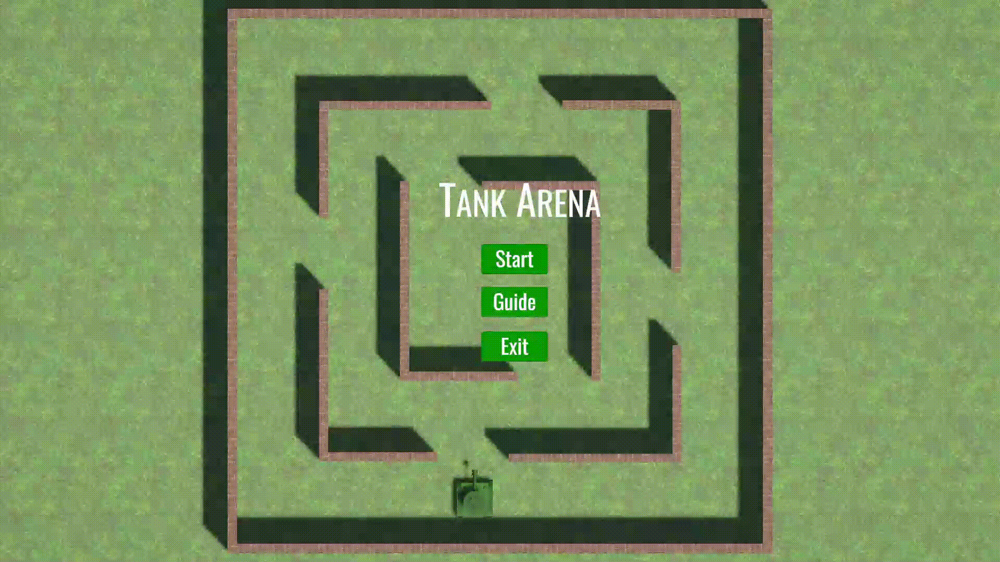

# Tank Arena

## Introduction

Tank Arena is an action-packed top-down tank shooter where you battle waves of enemy tanks in an intense arena. Survive increasingly challenging rounds, collect power-ups, and prove your skills as you fight through hordes of enemies. Navigate through a grid-based arena, gather keys to unlock chests, and collect health boosts to stay in the fight.

## How to Start Playing

### Prerequisites

- Unity 2021 or later
- Windows, macOS, or Linux operating system

### Running the Game

1. Clone or download this repository
2. Open the project in Unity
3. Navigate to the main game scene in `Assets/Scenes/`
4. Click the Play button in the Unity Editor to start the game
5. Alternatively, build the project (File > Build Settings) to create a standalone executable

## How to Play

### Controls

- **WASD**: Move your tank
- **Left & Right arrow ** or **J & K**: Aim your turret
- **Space or Enter**: Fire bullets
- **ESC**: Pause/Menu

### Gameplay

- **Objective**: Survive waves of enemy tanks and progress through rounds
- **Enemies**: Red enemy tanks spawn at the corners and patrol the arena, shooting at you on sight
- **Keys**: Defeat all enemies in a wave to spawn a key at the last enemy's position
- **Chests**: Collect keys to unlock chests containing power-ups
- **Health**: Pick up health boosts that spawn on specific rounds (1, 3, 10, 15, 20) to restore your health
- **Rounds**: Each round increases in difficulty with more enemies spawning
- **Game Over**: You lose when your health reaches zero

### Tips

- Keep moving to avoid enemy fire
- Use the arena walls for cover
- Collect health power-ups immediately when they appear
- Plan your route to collect keys and reach chests efficiently
- Watch out for enemy spawn patterns and anticipate their movements
